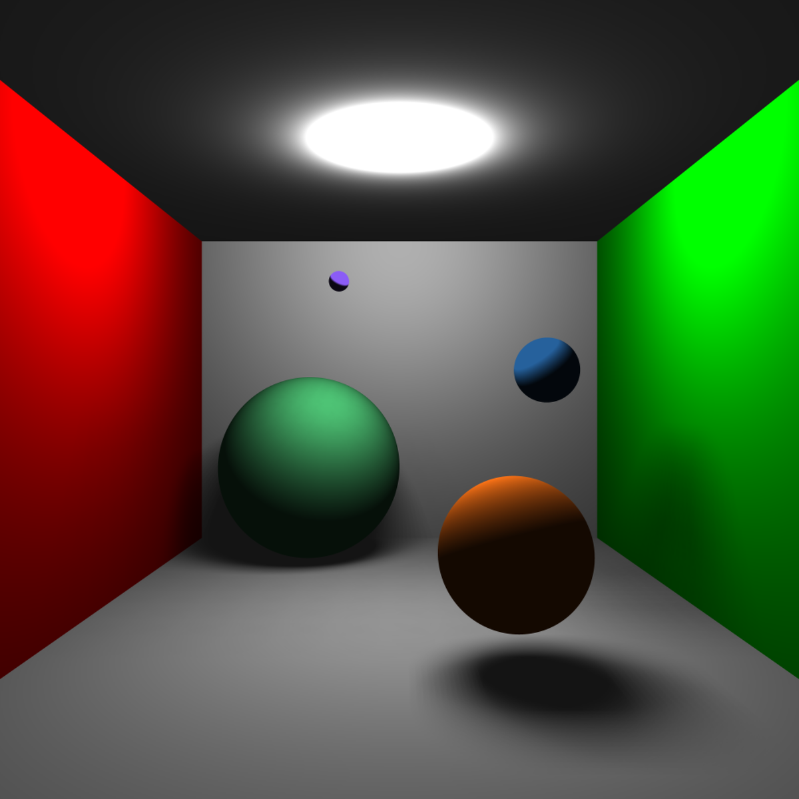
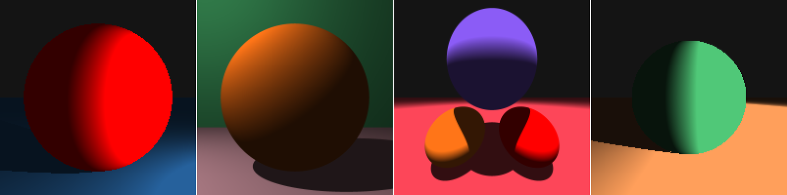

# John Andres

Computing Science and Mathematics student at the University of Alberta, Augustana, in Camrose, Alberta.

My long term goal is to be a graphics researcher. I'd love to follow a path like
[Christoph Peters](https://momentsingraphics.de/), who went from Intel and NVIDIA to graphics research at
TU Delft. Before that I want to work with a team on graphics programming, graphics engine tooling or
similar roles, and I'm looking for an internship or full-time position doing that.

## Right now

### A ray tracer in C++

I'm writing a [ray tracer in C++](https://github.com/0JEA/lattice-based-sampling-in-computer-graphics) from
scratch as a directed study with Thibaud Lutellier, and turning it into a path tracer, with the following
goals:

- Compare different sampling methods, like lattice-based sampling, Sobol, and the many types of random noise
  sampling such as blue noise.
- Implement papers that deeply interest me, such as simulating the noise from specific types of film
  ([Newson et al.](https://hal.science/hal-01520260v1/file/Film_grain_synthesis_computer_graphics_forum.pdf)).
- Learn how light interacts with different types of materials, such as fog, fabric and porous materials.
- Develop a strong understanding of how to get realism without needing the raw compute power, using methods
  like [Kubelka-Munk compositing](https://grail.cs.washington.edu/projects/watercolor/), Kaneko et al.
  parallax mapping and displacement mapping.
- Move it to Vulkan, so I'm working with a real GPU graphics API.

  

A Cornell box with a sphere light and soft shadows, and some of my earlier shading tests.

### Seraph

[Seraph](https://seraph.ink) is a studio management platform for tattoo artists. It's a private repo, not
for distribution.

- Full integration for entire shops or solo artists: payments, deposits, refunds, phone calls, texts, and
  appointment scheduling (with your own Google Calendar or ours, they sync). Aftercare signing and legal
  identification are done online too.
- Built around the privacy, anti-spam, consumer protection and public health rules in Alberta, British
  Columbia, Manitoba and Ontario, including the client consent and records shops are required to keep.
- A full web app that feels and functions like a normal app. The goal was to keep users and clients from
  needing to download an app. (Screenshots on the website are taken directly from the current build.)
- Built with the artist, shop and client in mind, with minimal fees.
  The purpose is to give the market a strong, competing full solution that's
  more than affordable, allowing artists to focus on their art.

### Private tools for website management

I have a handful of client websites and servers I manage. Some of them I was lucky enough to build from
scratch, such as [Rose City Originals](https://rosecityogs.com/) and [Camrose Buzz](https://camrosebuzz.ca/),
but others use platforms like WordPress. Managing websites by myself across many different platforms makes
for a lot of extra work, so I've built the following tools to help myself and my clients:

- A site hub on my VPS so I can see basic stats for every site in a single spot, such as response times to
  their server and through Cloudflare, uptime, notifications for new crash logs, and a log of changes.
- A backup tool that works similar to snapshots, so backups build on top of each other. The goal was to have
  monthly, weekly and daily backups without using a lot of storage space. It uses restic, which only stores
  what changed each night.

Last summer I held an NSERC USRA studying decryption failure in lattice-based post-quantum encryption, which
is where the AVX2 C++ and the interest in lattices came from.

Outside of my own projects I'm president of the Computing Science Club, where I lead our events and
hackathons, and a TA for web development. This winter I'm giving four talks at the Augustana Student
Academic Conference.

Before computing I was a tattoo artist for about five years, and I still manage Rose City Originals, the
shop Seraph started at.

[johnandres.ca](https://johnandres.ca) · [LinkedIn](https://www.linkedin.com/in/john-andres) ·
[0johnandres@gmail.com](mailto:0johnandres@gmail.com)
